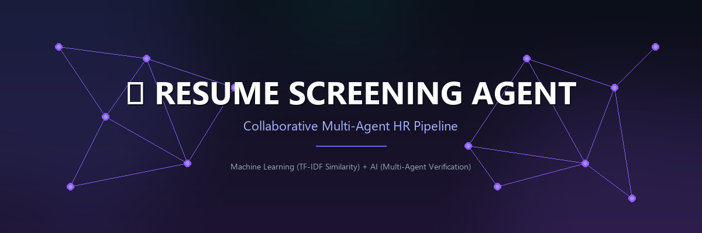

# 🚀 Resume Screening Agent: Collaborative Multi-Agent AI System

[](https://github.com/Snehan0911/Resume-Screening-Agent/actions/workflows/ci.yml)
[](https://resume-screening-agent-kjzscaefcqf2sf5dxj6gha.streamlit.app/)


Resume Screening Agent website :- "https://resume-screening-agent-kjzscaefcqf2sf5dxj6gha.streamlit.app/"

## 📖 Introduction & Cover Page 

Welcome to **Resume Screening Agent** - a state-of-the-art collaborative Multi-Agent Resume Screening platform designed to automate, optimize, and audit candidate resume profiles against target Job Descriptions. 

This platform represents **honest engineering** designed to solve a critical HR challenge: screening candidates at scale while preventing AI score inflation, hallucinations, and parsing errors through cooperative, multi-step verification.

*   **Platform Version**: v2.0.0 (Pure Python Stack)
*   **Target Core AI**: Gemini 3.8 Flash & Gemini 3.5 Flash-Lite (`gemini-3.8-flash`, `gemini-flash-latest`, `gemini-3.5-flash-lite`)
*   **Machine Learning Engine**: TF-IDF + Cosine Similarity (Scikit-Learn)
*   **Visual Interface**: Streamlit Dashboard Web Interface
*   **Live Web App**: [https://resume-screening-agent-kjzscaefcqf2sf5dxj6gha.streamlit.app/](https://resume-screening-agent-kjzscaefcqf2sf5dxj6gha.streamlit.app/)

---

## ⚡ Quick Start Details

Get the entire project running in **3 simple steps** :

1.  **Configure API Credentials**:
    *   Create a file named `.env` in the root directory.
    *   Paste your Gemini API key:
        ```env
        GEMINI_API_KEY=your_gemini_api_key_here
        ```
2.  **Initialize the Virtual Environment**:
    *   Open your terminal in the project root and run:
        ```bash
        python -m venv .venv
        .\.venv\Scripts\Activate.ps1   # Windows
        # For macOS / Linux: source .venv/bin/activate
        ```
3.  **Install & Run**:
    *   Install the required dependencies:
        ```bash
        pip install -r requirements.txt --cache-dir D:\pip-cache
        ```
    *   **Option A: Start the Streamlit Dashboard (GUI)**:
        ```bash
        streamlit run app.py
        ```
        Open your local browser to: **`http://localhost:8501`**.
        
        *(Or access the public cloud deployment: [resume-screening-agent.streamlit.app](https://resume-screening-agent-kjzscaefcqf2sf5dxj6gha.streamlit.app/))*.
    *   **Option B: Run from Command Line (CLI)**:
        Run the screening process on a folder of resumes directly from the terminal:
        ```bash
        python cli.py --jd sample_jd.txt --resumes sample_resumes/ --output results.json --format json
        ```
        Parameters:
        * `--jd`: Path to the job description text file.
        * `--resumes`: Path to the folder containing candidate resumes.
        * `--output`: Filepath where the output should be saved.
        * `--format`: Output format, choosing from `json`, `csv`, `md`. (Default: `json`).
        * `--model`: The Gemini core model to use. (Default: `gemini-3.8-flash`).
    *   **Option C: Run in a Docker Container**:
        Build and run the Streamlit dashboard in a container:
        ```bash
        # Build the container image
        docker build -t resume-screening-agent .
        
        # Run the container (injecting your local API key)
        docker run -p 8501:8501 --env-file .env resume-screening-agent
        ```
        Open your browser to: **`http://localhost:8501`**.
    *   **Option D: Run in Jupyter Notebook (All-in-One)**:
        Open and run [`Resume_Screening_Agent.ipynb`](./Resume_Screening_Agent.ipynb) for an interactive, end-to-end workflow containing all pipeline stages, agents, and analytics in a single file.

4.  **Run the Testing Suite**:
    *   Verify text parsing, NLP similarities, and schema serialization:
        ```bash
        pytest tests/
        ```

---

## 🏗️ System Architecture & Workflow

Our agentic pipeline is built as a custom, lightweight workflow using Python, Scikit-Learn, and the official Google Gemini SDK. 

```
                  ┌────────────────────────────────────────┐
                  │   📥 User Uploads Resumes + Paste JD    │
                  └───────────────────┬────────────────────┘
                                      │
                                      ▼
                  ┌────────────────────────────────────────┐
                  │      📋 Agent 1: JD Analyzer           │
                  │  Extracts role, skills, exp, education │
                  └───────────────────┬────────────────────┘
                                      │
                                      ▼
                  ┌────────────────────────────────────────┐
                  │    📄 Resume Text Parsers (PDF/DOCX)   │
                  │  Extracts raw text from multiple files │
                  └───────────────────┬────────────────────┘
                                      │
                                      ▼
                  ┌────────────────────────────────────────┐
                  │   📊 ML Engine: TF-IDF vectorization   │
                  │        & Cosine Similarity Score       │
                  └───────────────────┬────────────────────┘
                                      │
                                      ▼
                  ┌────────────────────────────────────────┐
                  │      🔍 Agent 2: Resume Parser         │
                  │   Extracts structured candidate data   │
                  └───────────────────┬────────────────────┘
                                      │
                                      ▼
                  ┌────────────────────────────────────────┐
                  │       ⚖️ Agent 3: Evaluator            │
                  │ Scores technical, exp, edu & role fit  │
                  └───────────────────┬────────────────────┘
                                      │
                                      ▼
                  ┌────────────────────────────────────────┐
                  │    🛡️ Agent 4: Quality Assurance       │
                  │ Audits scores & catches hallucinations │
                  └───────────────────┬────────────────────┘
                                      │
                                      ▼
                  ┌────────────────────────────────────────┐
                  │   👑 Agent 5: Ranking & Aggregator     │
                  │ Ranks shortlist, Qs & email drafts     │
                  └───────────────────┬────────────────────┘
                                      │
                                      ▼
                  ┌────────────────────────────────────────┐
                  │     💻 Streamlit Web UI Dashboard      │
                  │ Candidate scores, rankings, QA & guides│
                  └────────────────────────────────────────┘
```

### 📊 The Machine Learning Similarity Engine
We implement a mathematical keyword/conceptual overlap check using **Scikit-Learn**:
*   **TF-IDF (Term Frequency-Inverse Document Frequency)**: Vectorizes the Job Description and all candidate resumes, converting raw English text into mathematical vectors representing word importance.
*   **Cosine Similarity**: Measures the cosine of the angle between the Job Description vector and each candidate resume vector. This computes a baseline percentage overlap score (0-100%) indicating how close the resume vocabulary is to the requirements.

### 🤖 The 5 Collaborative AI Agents Pipeline

Our backend architecture (`pipeline.py`) features **five specialized agent classes** working cooperatively:

1. 📋 **Agent 1 – JD Analyzer (`JDAnalyzerAgent`)**: 
   * **Role**: Parses raw, unstructured Job Description text into a typed Pydantic schema (`JDAnalysis`).
   * **Key Outputs**: Target role title, required mandatory skills, preferred/bonus skills, minimum experience threshold (years), required education degree, and primary responsibilities.
   * **Why it matters**: Upstream structuring prevents ambiguity and anchors all subsequent agent evaluations against standardized criteria.

2. 🔍 **Agent 2 – Resume Parser (`ResumeParserAgent`)**: 
   * **Role**: Ingests raw resume text (from PDF, Word, or TXT) and transforms it into a clean, typed profile (`CandidateProfile`).
   * **Key Outputs**: Candidate full name, email, phone, extracted technical & soft skills, calculated total years of experience, educational degrees/institutions, and chronological work history.
   * **Why it matters**: Eliminates parsing errors and standardizes candidate data for fair downstream evaluation.

3. ⚖️ **Agent 3 – Evaluator (`EvaluatorAgent`)**: 
   * **Role**: Conducts a multi-dimensional comparison between the candidate profile and the structured JD analysis.
   * **Key Outputs**: Generates a 4-pillar scorecard (Technical Skills, Experience, Education, Role Fit) from 0 to 100, produces an exhaustive `skills_matrix` comparing every required/preferred JD skill with verifiable resume evidence, identifies matching & missing skills, lists pros and cons, and assigns an initial recommendation (`Shortlist`, `Interview`, or `Reject`).
   * **Why it matters**: Provides explainable, category-level scoring rather than a black-box guess.

4. 🛡️ **Agent 4 – Quality Assurance (`QualityAssuranceAgent`)**: 
   * **Role**: Functions as an autonomous fact-checker and auditor on the Evaluator Agent's output.
   * **Key Outputs**: Cross-references the evaluation draft with the raw work history timeline and the Scikit-Learn **TF-IDF Cosine Similarity** baseline (0-100%). It detects score inflation, penalizes missing experience thresholds, catches hallucinated skills (skills claimed by the evaluator that are absent in the resume), and writes an adjusted score with a clear justification.
   * **Why it matters**: Guarantees consistency, honesty, and safeguards against LLM hallucinations.

5. 👑 **Agent 5 – Ranking & Aggregator (`RankingAgent`)**: 
   * **Role**: Evaluates the entire audited candidate pool globally to rank candidates and assemble the final recruiter deliverables.
   * **Key Outputs**: Ranks candidates from best to worst based on verified QA scores, writes an executive pool summary, designs 3-4 custom tailored interview questions per candidate probing their specific gaps (including expected answer benchmarks and red-flag warnings), and drafts personalized outreach and rejection email templates.
   * **Why it matters**: Delivers an end-to-end recruitment package ready for hiring managers and recruiters.

> 💡 **Important Architecture & Interview Note**:
> While high-level summaries sometimes refer to **four collaborative agents** (grouping the candidate-centric evaluation stages: Parser, Evaluator, QA, and Ranking), `pipeline.py` actually contains **five distinct agent classes**, with the **JD Analyzer Agent** as the critical first stage. In interviews and technical reviews, always explain all **five stages** in sequence.

---

## 🎨 UI/UX Design System & Interface Architecture

**Resume Screening Agent** features an **enterprise-grade, human-centric UI/UX design system** built to eliminate cognitive overload for hiring managers, recruiters, and candidates. The design combines **glassmorphism**, a **cyber-slate dark theme**, and **high-contrast visual cues** for instant scannability and fast decision-making.

A standalone, zero-dependency interactive prototype is available at [ui_ux_design.html](file:///d:/Projects/Resume%20Screening%20Agent/ui_ux_design.html).

---

### 🌈 Color Palette & Design Tokens

The color system is engineered for maximum readability, semantic visual hierarchy, and accessibility:

| Token / Variable | Hex Value | RGBA Glow / Accent | Semantic Role & UI Application |
| :--- | :--- | :--- | :--- |
| `--bg-dark` | `#080c14` | Solid | Deep obsidian workspace background canvas |
| `--bg-panel` | `#0e1526` | `rgba(14, 21, 38, 0.85)` | Elevated panels, glassmorphic headers, sticky top bar |
| `--bg-card` | `#141e33` | Solid | Interactive candidate cards, score containers, metric tiles |
| `--bg-card-hover` | `#1c2a47` | Solid | Hover and active focus state highlighting |
| `--border-color` | `#223254` | Solid | Structural card boundaries and divider lines |
| `--cyan` | `#38bdf8` | `rgba(56, 189, 248, 0.25)` | **Primary Accent**: Action buttons, active agent step, technical skills |
| `--emerald` | `#34d399` | `rgba(52, 211, 153, 0.25)` | **Success / Shortlist**: Top scores (80-100%), verified claims, strengths |
| `--amber` | `#fbbf24` | `rgba(251, 191, 36, 0.25)` | **Review / Warning**: Intermediate scores (50-79%), education pillars, QA audit |
| `--rose` | `#fb7185` | `rgba(251, 113, 133, 0.25)` | **Critical / Reject**: Missing skills, low alignment (0-49%), gap tags |
| `--purple` | `#c084fc` | Solid | **Agentic Intelligence**: Role fit indicators, interview question prompts |
| `--text-main` | `#f8fafc` | Solid | High-contrast typography for candidate names, primary headings |
| `--text-muted` | `#94a3b8` | Solid | Subheaders, metadata tags, secondary descriptions |

---

### 🔤 Typography & Font Hierarchy

*   **Primary Typeface**: `Plus Jakarta Sans`, sans-serif (Google Fonts) — modern geometric font optimized for legibility across variable DPI screens.
*   **Monospace & Numerical Metrics**: `JetBrains Mono` — for scores (`92/100`), percentages (`94%`), timeline dates, and runtime logs.
*   **Scale & Weights**:
    *   **Hero / Main Titles**: `20px - 24px` (Weight `800` Extrabold, letter-spacing `-0.5px`)
    *   **Section Headers & Metrics**: `14px - 16px` (Weight `700` - `800`)
    *   **Badges, Pills & Status Tags**: `11px - 12.5px` (Weight `600` - `700`, uppercase tracking `0.5px`)
    *   **Body & Descriptions**: `12px - 13.5px` (Weight `400` - `500`, line-height `1.5`)

---

### 🖥️ 3-Column Modern Workspace Cockpit

The user interface utilizes a responsive **3-Column Cockpit Layout** (`grid-template-columns: 340px 1fr 440px`), allowing hiring teams to manage the entire evaluation workflow on a single screen without context-switching:

```
┌───────────────────────────┬───────────────────────────────────┬───────────────────────────┐
│  📋 Column 1: Job Spec    │  📊 Column 2: Upload & Rankings   │  🔍 Column 3: Inspector   │
├───────────────────────────┼───────────────────────────────────┼───────────────────────────┤
│ • Target Role & Level     │ • Drag & Drop Dropzone            │ • Candidate Profile Head  │
│ • Editable JD Text Area   │ • Real-time Multi-Agent Ribbon    │ • 4-Pillar Scorecard Grid │
│ • Core Skill Tag Cloud    │ • Filter Tabs (All/Shortlist/etc) │ • Key Strengths (Green)   │
│ • Batch Action Buttons    │ • Ranked Candidate Cards          │ • Missing Gaps (Rose)     │
│                           │ • Live Score Badges & Avatars     │ • QA Fact-Checker Audit   │
│                           │                                   │ • Tailored Interview Kit  │
└───────────────────────────┴───────────────────────────────────┴───────────────────────────┘
```

1.  **Left Column: Job Requirements & Core Competencies (340px)**:
    *   Target role badge (`Senior Level`) and experience requirement indicators.
    *   Editable multi-line textarea pre-loaded with comprehensive requirements.
    *   Dynamic tag cloud displaying core competencies (`Python`, `FastAPI`, `React`, `Docker`, `AWS`, `PostgreSQL`, `Redis`).
2.  **Center Column: Upload Dropzone & Ranked Leaderboard (Flexible 1fr)**:
    *   **Interactive Dropzone**: Multi-format drag-and-drop supporting `.pdf`, `.docx`, and `.txt` files with visual pulse effects on hover/dragover.
    *   **Multi-Agent Progress Ribbon**: Live visual step tracking animating from `Agent 1 (Parser)` ➔ `Agent 2 (Evaluator)` ➔ `Agent 3 (QA Auditor)` ➔ `Agent 4 (Interview Coach)`.
    *   **Smart Filter Navigation**: One-click category chips displaying candidate counts (`All`, `Shortlist`, `Review`, `Rejected`).
    *   **Candidate Ranking Cards**: Displays candidate avatar initials, current role, summary, score pill, and verdict tag.
3.  **Right Column: Deep-Dive Candidate Inspector (440px)**:
    *   **4-Pillar Scorecard Grid**: Individual metric cards for **Technical Skills**, **Experience Depth**, **Education Match**, and **Role Fit**, each featuring animated micro-progress bars.
    *   **Strengths & Gaps Pills**: Color-coded badges highlighting verified technical matches (Emerald) and missing skill gaps (Rose).
    *   **QA Fact-Checker Box**: Transparent audit summary displaying date timeline checks and TF-IDF mathematical vector similarity percentages.
    *   **Tailored Interview Question Kit**: Category-specific interview prompts (*Technical Deep-Dive*, *Architecture & Scale*, *Behavioral Leadership*) tailored specifically to challenge the candidate's gaps.

---

### ✨ Micro-Interactions & UX Polish

*   **⚡ Pulse & Status Glow Animations**: The active multi-agent pipeline step pulses using CSS `@keyframes pulse` with soft cyan box-shadow glows.
*   **🖱️ Card Hover & Selection States**: Candidate cards slide smoothly (`transform: translateX(4px)`) on hover with cyan border illumination when selected.
*   **📥 Seamless Drag-and-Drop Feedback**: Dropzone scales up (`scale(1.02)`) with a glowing border upon file dragover.
*   **📊 Dynamic Client-Side Filtering & Sorting**: Instant re-rendering and count recalculation without page reload.
*   **📱 Responsive & Accessible Layout**: Sticky navigation bar, fluid flex/grid wrappers, and high-contrast WCAG-compliant text.

---

## 🧪 Sample Test Cases & Expected Outcomes

We have pre-configured a test directory containing **11 mock candidate resumes** of varying alignments. Run a test batch in the UI and verify that the scoring matches the expected classifications:

| Candidate Name | File Name | Profile Type | Key Skills | Expected Score | Expected Recommendation |
| :--- | :--- | :--- | :--- | :---: | :---: |
| **Alice Smith** | [alice_smith_resume.txt](file:///d:/Projects/Resume%20Screening%20Agent/sample_resumes/alice_smith_resume.txt) | Senior Full-Stack | Python, FastAPI, React, TS, Docker, AWS | **90+** | **Shortlist** |
| **Kevin Baker** | [kevin_baker_resume.txt](file:///d:/Projects/Resume%20Screening%20Agent/sample_resumes/kevin_baker_resume.txt) | Mid Full-Stack | Python, FastAPI, React, TS, Docker | **80-89** | **Shortlist / Interview** |
| **Fiona Gallagher** | [fiona_gallagher_resume.txt](file:///d:/Projects/Resume%20Screening%20Agent/sample_resumes/fiona_gallagher_resume.txt) | Senior Backend | Python, FastAPI, PostgreSQL, Celery | **70-79** | **Interview** |
| **Helen Vance** | [helen_vance_resume.txt](file:///d:/Projects/Resume%20Screening%20Agent/sample_resumes/helen_vance_resume.txt) | Senior Frontend | React, Next.js, TypeScript, Vite | **65-75** | **Interview** |
| **Bob Jones** | [bob_jones_resume.txt](file:///d:/Projects/Resume%20Screening%20Agent/sample_resumes/bob_jones_resume.txt) | Data Scientist | ML, PySpark, Pandas, Airflow | **40-55** | **Reject** |
| **Evan Wright** | [evan_wright_resume.txt](file:///d:/Projects/Resume%20Screening%20Agent/sample_resumes/evan_wright_resume.txt) | DevOps Eng. | AWS, Kubernetes, Terraform, Ansible | **40-50** | **Reject** |
| **Charlie Brown** | [charlie_brown_resume.txt](file:///d:/Projects/Resume%20Screening%20Agent/sample_resumes/charlie_brown_resume.txt) | Junior Frontend | React, TailwindCSS, basic JS | **35-49** | **Reject** |
| **George Costanza** | [george_costanza_resume.txt](file:///d:/Projects/Resume%20Screening%20Agent/sample_resumes/george_costanza_resume.txt) | Junior Web Dev | HTML, CSS, Vanilla JS, Bootstrap | **15-30** | **Reject** |
| **Diana Prince** | [diana_prince_resume.txt](file:///d:/Projects/Resume%20Screening%20Agent/sample_resumes/diana_prince_resume.txt) | Project Manager | Jira, Agile, PMP (Non-coding) | **0-15** | **Reject** |
| **Ian Malcolm** | [ian_malcolm_resume.txt](file:///d:/Projects/Resume%20Screening%20Agent/sample_resumes/ian_malcolm_resume.txt) | Sysadmin | Linux, Server Rack, Bash Scripting | **0-15** | **Reject** |
| **Julia Robinson** | [julia_robinson_resume.txt](file:///d:/Projects/Resume%20Screening%20Agent/sample_resumes/julia_robinson_resume.txt) | UI/UX Designer | Figma, Sketch, Visual Prototyping | **0-10** | **Reject** |

---

### 📋 Step-by-Step Demo Flow
To conduct a demo screening run:
1.  **Open the Web App**: Navigate to `http://localhost:8501`.
2.  **Review the Job Description**: The dashboard pre-fills a standard **Senior Full-Stack Engineer** job description.
3.  **Upload Resumes**: 
    *   Click on the file uploader.
    *   Select candidates from the [sample_resumes/](file:///d:/Projects/Resume%20Screening%20Agent/sample_resumes) folder.
4.  **Execute Screening**: Click the **Run Multi-Agent ML/AI Screening Pipeline** button.
5.  **Monitor Logs**: A progress bar and an active log terminal will display steps in real-time.
6.  **Explore Final Dashboard**: 
    *   Review the candidate leaderboard ranked by final score.
    *   Explore candidate detailed tabs (Match & Gaps, Interview Questions, QA Audits, Profile Details).

---

## 🛠️ Troubleshooting Guide

### 1. `type object 'dummy' has no attribute 'model_json_schema'`
*   **Cause**: The Python virtual environment has Pydantic v1, but the Google Gemini SDK expects Pydantic v2.
*   **Solution**: Run `pip install "pydantic>=2.0.0" --cache-dir D:\pip-cache` and restart Streamlit.

### 2. `404 This model models/gemini-2.5-flash is no longer available`
*   **Cause**: The older `gemini-2.5-flash` model has been deprecated in Google AI Studio.
*   **Solution**: Ensure `MODEL_NAME` in [pipeline.py](file:///d:/Projects/Resume Screening Agent/pipeline.py) is set to `"gemini-3.5-flash"`.

### 3. Disk Space Full (`OSError: [Errno 28] No space left on device`)
*   **Cause**: The `C:` drive has ran out of temporary storage space.
*   **Solution**: Redirect package installations to your `D:` drive by adding the `--cache-dir D:\pip-cache` flag to all pip commands.

---

## 📦 Assets & Folder Directory Structure

Here is the directory layout of your clean Python workspace:

```
/Resume-Screening-Agent
  ├── .github/workflows/
  │    └── ci.yml                 # GitHub Actions CI pipeline configuration
  ├── assets/
  │    └── banner.png             # The high-resolution project banner image
  ├── sample_resumes/             # Folder containing the 11 mock candidate resumes
  ├── tests/                     # Automated unit testing suite folder
  │    └── test_pipeline.py       # Unit tests for text parsing, similarity engine, and pipeline
  ├── .env                       # Local keys configuration (GEMINI_API_KEY)
  ├── .gitignore                 # Global Git ignore specifications
  ├── requirements.txt           # Unified Python packages dependencies file
  ├── pipeline.py                # Text extraction, TF-IDF + Cosine Similarity, AI Agents, & Core Orchestrator
  ├── cli.py                     # Command-line screening utility (outputs JSON, CSV, or Markdown)
  ├── app.py                     # Streamlit web user interface dashboard (with CSV/JSON/MD exports)
  ├── ui_ux_design.html          # Interactive Standalone UI/UX Design System & Prototype
  ├── presentation.html          # Interactive browser-based presentation slide deck
  ├── presentation_deck_guide.md # Complete slide-by-slide presentation guide & speaker script
  ├── Dockerfile                 # Containerized image setup config
  └── README.md                  # Complete system documentation
```

---

## 🔍 Codebase Explained Line-By-Line

---

### 📄 1. [requirements.txt](file:///d:/Projects/Resume%20Screening%20Agent/requirements.txt)
*   **Line 1 (`streamlit>=1.16.0`) 💻**: Installs Streamlit, the framework used to design our beautiful dark-theme web dashboard.
*   **Line 2 (`scikit-learn>=1.2.0`) 📊**: Installs Scikit-Learn to build the machine learning similarity engine (TF-IDF Vectorizer + Cosine Similarity calculations).
*   **Line 3 (`google-generativeai>=0.8.3`) 🧠**: Installs the Google Gemini Python SDK, allowing us to connect to the `gemini-3.5-flash` model.
*   **Line 4 (`pypdf>=3.9.0`) 📂**: Installs PyPDF, a library to parse and extract text strings from PDF resumes.
*   **Line 5 (`python-docx>=0.8.11`) 📝**: Installs python-docx to parse Microsoft Word (`.docx`) resume formats.
*   **Line 6 (`python-dotenv>=1.0.0`) 🔑**: Installs python-dotenv to read and inject keys from our local `.env` configuration file.
*   **Line 7 (`pydantic>=2.0.0`) 🛡️**: Installs Pydantic v2 to enforce Gemini's structured JSON outputs using typed schemas.
*   **Line 8 (`matplotlib>=3.5.0`) 📈**: Installs Matplotlib to render horizontal bar charts of candidate scores directly in our dashboard.
*   **Line 9 (`pandas>=1.5.0`) 📋**: Installs Pandas to organize candidate tables, ranks, and metadata.

---

### ⚙️ 2. [pipeline.py](file:///d:/Projects/Resume%20Screening%20Agent/pipeline.py)
*   **Lines 1-27 📥**: Imports necessary libraries (`os`, `json`, `logging` for runtime tracking, `pypdf`, `docx`, `google.generativeai`, `pydantic`, `TfidfVectorizer`, `cosine_similarity`) and reads environment configurations.
*   **Lines 28-81 🧠**: Defines default `MODEL_NAME` and `generate_structured_json` with multi-model fallback cascading (handling quota limits and model deprecations).
*   **Lines 83-135 📄 (Part 1: Document Parsers)**:
    *   `parse_pdf`: Extracts text using `pypdf.PdfReader` across all document pages.
    *   `parse_docx`: Extracts paragraphs and loops through Word tables, merging cells with pipe `|` delimiters.
    *   `parse_txt`: Reads text with UTF-8 encoding handling decoding exceptions safely.
    *   `extract_text_from_file`: Central parser router dynamically selecting the reader by file extension.
*   **Lines 137-166 📊 (Part 2: ML Similarity Engine)**:
    *   `compute_ml_similarity`: Prepends Job Description at index 0 and candidate resumes from index 1.
    *   Applies `TfidfVectorizer` (with English stop-words filtering) to calculate term frequency matrices.
    *   Calculates `cosine_similarity(jd_vector, resume_vectors)` to compute baseline mathematical overlap percentages (0-100%).
*   **Lines 168-249 🛡️ (Part 3: Pydantic v2 Validation Schemas)**: Defines strictly-typed schemas: `CandidateProfile`, `JDAnalysis`, `ScorecardCategory`, `SkillMatchDetail`, `EvaluationResponse`, `QAResponse`, `InterviewQuestionDetail`, `CandidateRankingDetail`, and `BatchRankingReport`.
*   **Lines 250-472 🤖 (Part 4: The 5 Collaborative AI Agents)**:
    *   **Lines 253-281 (`JDAnalyzerAgent` - Agent 1) 📋**: Structures raw Job Description text into typed `JDAnalysis` (role title, required skills, preferred skills, min experience, education, key responsibilities).
    *   **Lines 283-313 (`ResumeParserAgent` - Agent 2) 🔍**: Ingests raw candidate resume text and extracts structured `CandidateProfile` (contact, skills, experience years, education, work history).
    *   **Lines 315-362 (`EvaluatorAgent` - Agent 3) ⚖️**: Grades candidates across 4 categories (Technical Skills, Experience, Education, Role Fit), builds an itemized `skills_matrix`, and returns `EvaluationResponse`.
    *   **Lines 364-408 (`QualityAssuranceAgent` - Agent 4) 🛡️**: Audits evaluations against candidate career timelines and the TF-IDF Cosine Similarity score to prevent score inflation and eliminate hallucinations. Returns `QAResponse`.
    *   **Lines 410-472 (`RankingAgent` - Agent 5) 👑**: Ranks the pool, writes an executive batch summary, generates 3-4 custom tailored interview questions with expected answers and red flags, and drafts personalized outreach and rejection email templates.
*   **Lines 474-652 🚀 (`run_screening_pipeline`)**: Master orchestrator chaining JD analysis, file parsing, TF-IDF calculations, candidate-level evaluation & QA loops, and final ranking.

---

### 💻 3. [app.py](file:///d:/Projects/Resume%20Screening%20Agent/app.py)
*   **Lines 1-17 📥**: Imports UI libraries (`streamlit`, `matplotlib.pyplot`, `pandas`, `shutil`, `tempfile`) and imports our pipeline modules.
*   **Lines 19-24 🚀**: Configures Streamlit page title, icons, and wide layout.
*   **Lines 26-82 🎨**: Injects custom CSS styling (dark-mode color scheme `#0b0f19`, glassmorphic containers, terminal consoles, and purple glow colors).
*   **Lines 84-89 🔄**: Initializes session states (`screening_results` and `logs`).
*   **Lines 91-114 ⚙️**: Builds the sidebar interface (model selector dropdown, pipeline agents descriptions, and testing directories locator).
*   **Lines 116-120 🚀**: Renders gradient title headers.
*   **Lines 122-167 📄**: Renders the input screen. Contains a textarea with a pre-filled JD and a file uploader supporting drag-and-drop file inputs.
*   **Lines 169-285 (Pipeline Runner Block) 🚀**: Triggers inline when the "Run" button is pressed:
    *   Creates a temporary directory and writes uploaded files.
    *   Iterates through documents, extracts text, and runs the TF-IDF Cosine Similarity engine.
    *   Loops through candidates: invokes the Parser Agent, Evaluator Agent, and QA Agent in sequence.
    *   Updates the on-screen progress bar and prints log updates in real-time to the console view.
    *   Calls the Ranking Agent to rank the final shortlist.
*   **Lines 286-302 (Clean up & Refresh) 🧹**: Clears the temporary directories and triggers `st.rerun()` to render the completed results view.
*   **Lines 304-360 (View Completed Results Screen) 🏆**: Renders KPI cards (screened count, average scores, top candidate name) and displays the global pool summary callout.
*   **Lines 362-429 (Leaderboard Grid) 📊**: Renders the candidate table and compiles a horizontal bar chart of candidate scores using Matplotlib.
*   **Lines 431-540 (Detailed Inspector Panel) 🔍**: Sets up tabbed view blocks for candidate profiles:
    *   *Rating Scorecard & Gaps*: Category score progress bars, matching skills, missing skills, and pros/cons lists.
    *   *Tailored Interview Questions*: Renders the custom questions generated by the Ranking Agent.
    *   *QA Audit Logs*: Displays original vs. adjusted scores and the QA auditor's justification.
    *   *Extracted Profile Details*: Shows work history timelines and education fields.

---

### 🎨 4. [ui_ux_design.html](file:///d:/Projects/Resume%20Screening%20Agent/ui_ux_design.html)
*   **Lines 1-31 🎨**: Defines CSS `:root` design tokens (obsidian slate background `--bg-dark`, cyber blue `--cyan`, emerald `--emerald`, warm amber `--amber`, rose `--rose`).
*   **Lines 46-164 🧭**: Implements sticky frosted glass navigation bar, real-time telemetry pills, and the animated 4-Agent pipeline step indicator ribbon.
*   **Lines 166-350 📐**: Builds the responsive 3-column cockpit layout: Left Job Spec panel, Center Drag-and-Drop dropzone + candidate leaderboard, Right Inspector panel.
*   **Lines 351-470 📊**: Styles candidate ranking cards, score badges, status pills, and category filter chips (`All`, `Shortlist`, `Interview`, `Reject`).
*   **Lines 471-636 🔍**: Styles the candidate deep-dive audit view, 4-pillar scorecard progress bars, strengths/gaps badges, QA audit callout box, and interview questions cards.
*   **Lines 638-873 🏗️**: Pure semantic HTML5 markup structuring the entire interactive screening interface.
*   **Lines 875-1428 ⚡**: Vanilla JavaScript reactive state engine handling drag-and-drop file reading, simulated multi-agent progress progression, dynamic scoring, filtering, candidate inspection, sample batch loading, and CSV data export.

---

### 📟 5. [cli.py](file:///d:/Projects/Resume%20Screening%20Agent/cli.py)
*   **Command Line Arguments Parsing ⚙️**: Uses Python's standard `argparse` library to read target job description paths, resume directory paths, format types (`json`/`csv`/`md`), and core Gemini models.
*   **Pipelines Execution & Console Logs 📟**: Executes the centralized `run_screening_pipeline` and outputs agent workflow logs in real-time.
*   **Multi-Format Export Writers 💾**: Translates Pydantic structures and writes them to JSON files, clean candidate rankings to CSV files, or compiles complete Recruiter Batch reports in Markdown.

---

### 🧪 6. [tests/test_pipeline.py](file:///d:/Projects/Resume%20Screening%20Agent/tests/test_pipeline.py)
*   **Unit & Parser Tests 📄**: Verifies document readers against text extraction functions.
*   **Mathematical Vector Similarity Tests 📊**: Asserts that `TfidfVectorizer` and Cosine Similarity equations perform as expected.
*   **API call Isolation & Mocking 🛡️**: Patches the Google Gemini API generative model responses to isolate the pipeline orchestrator, testing schema validations without internet calls or rate-limiting.

---

### ⚙️ 7. [.github/workflows/ci.yml](file:///d:/Projects/Resume%20Screening%20Agent/.github/workflows/ci.yml)
*   **Triggers specifications ⚡**: Automates workflow triggers on every push and pull request targeted to the `main` branch.
*   **Multi-Version Python Testing Matrix 🐍**: Sets up automated build executors running on Ubuntu virtual machines across multiple Python versions (3.10 and 3.11).
*   **Dependencies Caching & Setup 💾**: Caches Python pip packages to speed up consecutive runtimes, installs project requirements, and executes `pytest tests/` in a clean environment.

---

## ✍️ Author Information

*   **Author**: Sneha Nuchha
*   **Email**: [snehanuchha@gmail.com](mailto:snehanuchha@gmail.com)
*   **LinkedIn**:https://www.linkedin.com/in/sneha-nuchha0911/

